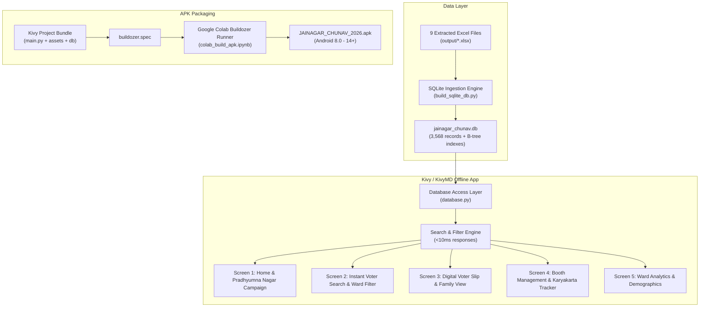

# 📱 "JAINAGAR CHUNAV" - Phase 2: Android APK Implementation Plan

> **For Claude:** REQUIRED SUB-SKILL: Use `executing-plans` to implement this plan task-by-task.

**Goal:** Build a high-performance, 100% offline Android mobile application (APK) titled **"JAINAGAR CHUNAV"** powered by an embedded SQLite database containing all 3,568 voters from the 9 wards, featuring prominent election promotion for candidate **Pradhyumna Nagar (प्रद्युम्न नागर)**, instant voter search, digital voter slips, family grouping, karyakarta election-day marking, and a 1-click Google Colab Buildozer APK build workflow.

**Architecture:**
- **Local Embedded SQLite Database:** Populated directly from the 9 generated Excel files (`JAINAGAR-Ward No-001.xlsx` through `009.xlsx`), indexed on `epic_number`, `name_hindi`, `name_english`, `(ward_number, serial_no)`, and `house_number` for sub-10ms query execution.
- **Frontend / Mobile UI:** Kivy + KivyMD (Material Design 3) optimized for smooth 60fps scrolling with `RecycleView`, bilingual Hindi/English rendering, responsive card layouts, and offline state persistence.
- **Candidate Promotion Engine:** Top hero card banner, dedicated candidate profile screen (Vision, Promises, Contact, Video/Audio appeal link), and 1-click WhatsApp election appeal sharing with voter slip generator.
- **Google Colab APK Build Recipe:** Self-contained `colab_build_apk.ipynb` and `buildozer.spec` designed to compile the release/debug APK in Google Colab within 15 minutes without local Android SDK/NDK setup.

**Tech Stack:** Python 3, SQLite3, Kivy 2.3+, KivyMD 1.2+, openpyxl/pandas (for DB builder), Buildozer (Android packaging via Google Colab).

---

## 🏗️ System Architecture & Workflow

---

## 📋 Phased Task Breakdown

### Task 1: SQLite Database Builder & High-Speed Data Ingestion

**Files:**
- Create: `build_sqlite_db.py`
- Create: `database.py`
- Test: `tests/test_database.py`

**Objectives:**
1. Ingest all 3,568 voter records from the 9 generated Excel files (`output/JAINAGAR-Ward No-001.xlsx` ... `009.xlsx`).
2. Schema structure:
   - Table `voters`: `id`, `ward_number` (INTEGER), `serial_no` (INTEGER), `epic_number` (TEXT), `name_hindi` (TEXT), `name_english` (TEXT), `father_hindi` (TEXT), `father_english` (TEXT), `husband_hindi` (TEXT), `husband_english` (TEXT), `house_number` (TEXT), `age` (INTEGER), `gender_hindi` (TEXT), `gender_english` (TEXT), `section_name` (TEXT), `voter_status` (TEXT DEFAULT 'unmarked'), `karyakarta_notes` (TEXT).
3. Indexes:
   - `idx_voters_ward_serial` on `(ward_number, serial_no)`
   - `idx_voters_epic` on `(epic_number)`
   - `idx_voters_name_hi` on `(name_hindi)`
   - `idx_voters_name_en` on `(name_english)`
   - `idx_voters_house` on `(ward_number, house_number)`
4. Fast query methods in `database.py`:
   - `search_voters(query_str, ward=None, limit=50, offset=0)`
   - `get_voter_by_id(voter_id)`
   - `get_family_members(ward, house_number, exclude_id)`
   - `get_ward_statistics(ward=None)`
   - `update_voter_status(voter_id, status, notes)`

---

### Task 2: Candidate Promotion & Campaign Asset Engine

**Files:**
- Create: `promotion_data.py`
- Create: `assets/candidate/` (Folder for photo, banner graphics, symbols)
- Create: `assets/fonts/` (High-legibility Unicode Devanagari font like `NotoSansDevanagari-Regular.ttf`)

**Objectives:**
1. Structured campaign profile for **Pradhyumna Nagar (प्रद्युम्न नागर)**:
   - **Candidate Name:** प्रद्युम्न नागर (Pradhyumna Nagar)
   - **Panchayat:** ग्राम पंचायत जैनगर (Jainagar)
   - **Slogan:** *"विकास का नया संकल्प — सबका साथ, गाँव का सर्वांगीण विकास"*
   - **Key Priorities / Manifesto (संकल्प पत्र):**
     1. स्वच्छ पेयजल एवं नल-जल योजना का विस्तार
     2. हर वार्ड में पक्की सीसी सड़कें एवं नालियाँ
     3. पंचायत में शिक्षा और स्वास्थ्य सुविधाओं का आधुनिकीकरण
     4. युवाओं के लिए खेल मैदान एवं रोजगार मार्गदर्शन
     5. 100% पारदर्शी ग्राम पंचायत प्रशासन (डिजिटल सेवाएँ)
   - **Office / Contact Address:** मुख्य बस स्टैंड, जैनगर
   - **WhatsApp Campaign Appeal Text:** Pre-templated WhatsApp message that includes candidate appeal + recipient voter slip details for viral campaign reach.

---

### Task 3: Kivy & KivyMD Mobile User Interface (UI First)

**Files:**
- Create: `main.py`
- Create: `ui/home_screen.py`
- Create: `ui/search_screen.py`
- Create: `ui/voter_slip_dialog.py`
- Create: `ui/candidate_screen.py`
- Create: `ui/analytics_screen.py`
- Create: `ui/styles.py`

**Screen Specifications:**
1. **Home Screen (`home_screen.py`)**:
   - **Top Hero Header:** Slogan banner, Candidate photo & appeal card ("प्रद्युम्न नागर - प्रधान पद प्रत्याशी / वार्ड प्रतिनिधि").
   - **Quick Stat Badges:** Total Voters (3,568), 9 Wards, Today's Polled Turnout counter.
   - **Quick Search Launcher:** Instant search bar jumping to search screen.
   - **Ward Grid:** 9 circular/card buttons (Ward 1 to Ward 9) for 1-tap filtering.
   - **Direct Actions:** "प्रत्याशी परिचय", "मतदाता खोजें", "वोटर पर्ची साझा करें".
2. **Instant Search Screen (`search_screen.py`)**:
   - Filter chips: `All Wards`, `Ward 1`, `Ward 2`, ... `Ward 9`.
   - Real-time search bar with debounce (search by Hindi name, English name, EPIC, Serial No, House No).
   - High-performance `RecycleView` list items displaying:
     - Serial No & Ward Badge
     - Voter Hindi & English Name
     - Relative Name (पिता/पति)
     - House No, Age, Gender
     - EPIC Number
     - Status indicator (Unmarked, Voted, Supporter)
3. **Digital Voter Slip Dialog (`voter_slip_dialog.py`)**:
   - Beautiful Rajasthan Panchayat Voter Slip mockup with seal/borders.
   - Candidate banner at the bottom ("सौजन्य: प्रद्युम्न नागर, जैनगर").
   - One-touch "Share on WhatsApp" intent button (creates instant formatted text/image for WhatsApp).
   - "Family Members in Same House" section (1-tap to see all voters in the same house).
   - Toggle buttons for karyakartas: [✔ मतदान किया] [⭐ समर्थक] [❓ संदेहास्पद] [✈ बाहर].
4. **Candidate Campaign Screen (`candidate_screen.py`)**:
   - Detailed biography, vision statement, photo gallery, promises list, office phone numbers, and social links.
5. **Ward Analytics Screen (`analytics_screen.py`)**:
   - Interactive charts: Ward-wise voter counts, Gender ratio (Male / Female), Age brackets (18-25 youth, 26-40, 41-60, 60+).

---

### Task 4: Google Colab Buildozer Packaging & 1-Click APK Generator

**Files:**
- Create: `buildozer.spec`
- Create: `colab_build_apk.ipynb`
- Create: `BUILD_APK_GUIDE.md`

**Objectives:**
1. **`buildozer.spec` Configuration:**
   - `title = JAINAGAR CHUNAV`
   - `package.name = jainagarchunav`
   - `package.domain = org.jainagar`
   - `source.include_exts = py,png,jpg,kv,atlas,ttf,db,json`
   - `requirements = python3,kivy,kivymd,sqlite3,pillow`
   - `orientation = portrait`
   - `android.permissions = READ_EXTERNAL_STORAGE, WRITE_EXTERNAL_STORAGE`
   - `android.api = 33`
   - `android.ndk_api = 21`
2. **`colab_build_apk.ipynb` Workflow:**
   - Free, cloud-based build requiring zero local Android SDK installations.
   - Step 1: Clone or upload the project ZIP.
   - Step 2: Install system build dependencies (`build-essential`, `libssl-dev`, `openjdk-17-jdk`, `buildozer`, `cython`).
   - Step 3: Run `buildozer -v android debug`.
   - Step 4: Download compiled `JAINAGAR_CHUNAV_2026.apk` directly to phone or PC.

---

### Task 5: Testing & Offline Verification

**Files:**
- Create: `tests/test_ui_mock.py`
- Verify database query performance is <10ms for 3,568 records.
- Verify Hindi Devanagari font rendering without glyph clipping.
- Verify offline persistence of Karyakarta voter status.
